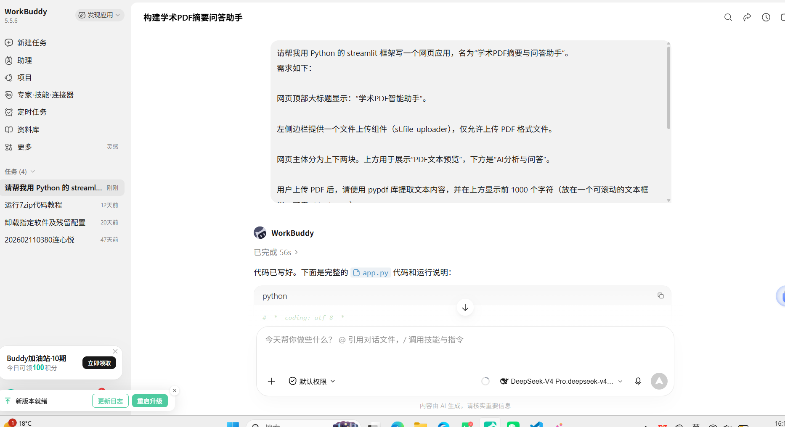
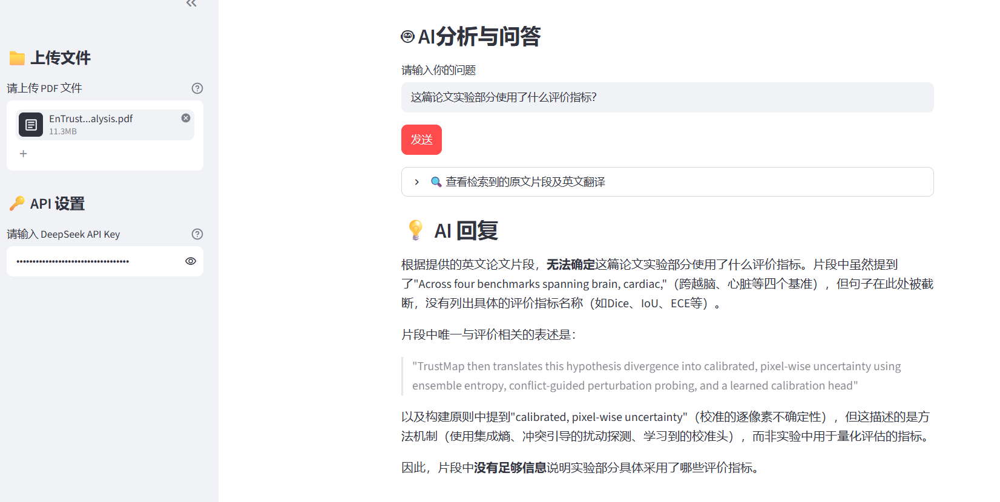
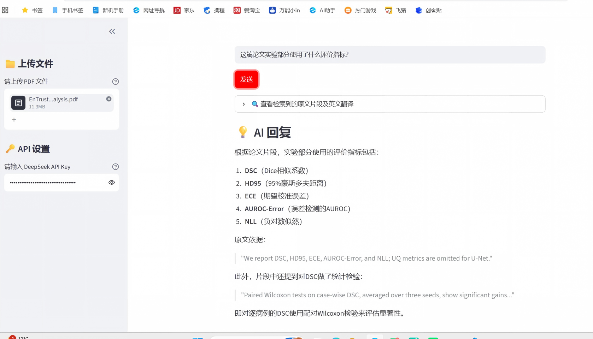
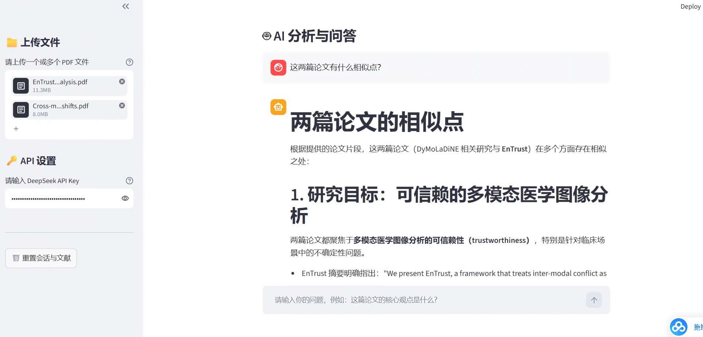
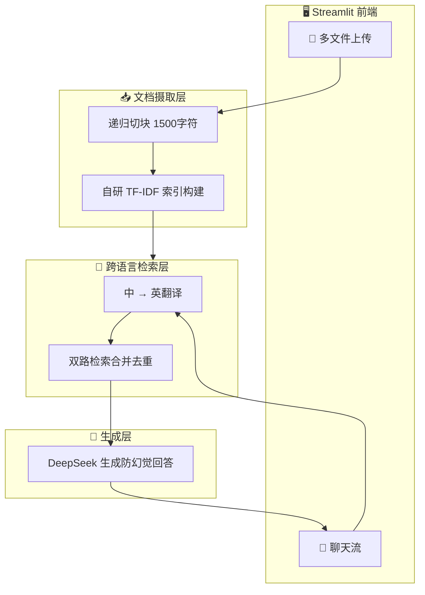

# 📚 Academic-PDF-Assistant · 学术PDF智能助手

> 一个用 **Vibe Coding** 模式、从零迭代到 V6 的学术论文阅读与问答工具 —— 上传英文论文，用中文提问，基于全文检索增强（RAG）给出**可溯源、防幻觉**的回答。

<p align="center">
  
  
  
  
  
</p>

---

## 👨‍💻 关于开发者

本项目由云南财经大学计算机科学与技术专业硕士研究生**连心悦**独立开发（Vibe Coding 模式）。
- 曾作为团队负责人，荣获**中国研究生数学建模竞赛（华为杯）国家级二等奖**；
- 本科期间多次斩获数学建模国奖，及国创大赛国铜、省金；
- 已在核心期刊**《计算机科学》**发表二作论文《基于RGB-IR多模态融合的番茄小目标检测方法研究》；
- **开发初衷**：作为一名发过论文的科研人员，深知跨语种文献阅读、多篇论文对比溯源的真实痛点，因此决定用 AI 打造一款真正懂科研的工具。

---

## 📖 项目背景

阅读英文论文时，我们常常遇到以下痛点：
- **语言门槛**：想用中文提问，但论文是英文，逐句翻译既慢又累；
- **上下文丢失**：直接把论文丢给大模型会超 Token 上限，读不到关键实验数据；
- **幻觉风险**：模型在信息不足时容易「一本正经地编造」；
- **多篇对比**：跨多篇论文做横向对比时，手动整理耗时耗力。

本项目基于 **Streamlit** 构建，通过 **RAG（检索增强生成）** 架构，让用户能够：**上传英文论文 → 用中文提问 → 检索最相关的原文片段 → 基于原文生成带出处的回答**。

---

## 📸 研发实录与核心突破

本项目的每一次跃升，都源于真实测试中暴露的痛点与 AI 协同迭代：

**1. Vibe Coding 需求提出（起点）**
通过自然语言描述需求，由 WorkBuddy 生成基础代码。


**2. V4 早期痛点：中英词汇不匹配导致检索失败**
中文提问无法准确召回英文实验段落，AI 诚实回答“无法确定”。


**3. V5 重大突破：双路检索与防幻觉溯源**
扩大切块并引入中英双路检索后，精准定位原文，列出 DSC、HD95 等指标并附带引用原句。


**4. V6 终极形态：跨文献多文对比推理**
支持多文件上传，Chat 对话流 UI，一键输出多篇论文的横向对比。


---

## ✨ 核心功能与架构

| 能力 | 说明 |
|------|------|
| 📁 **多文件对比** | 一次上传多篇 PDF，自动合并全文统一索引，支持跨文献横向对比 |
| 🌐 **跨语言检索** | 中文问题先经 DeepSeek 翻译成学术英语，再命中英文段落，解决词汇不匹配问题 |
| 🎯 **可溯源防幻觉** | 检索出的原文片段以折叠面板展示，AI 回答须引用原句，杜绝凭空编造 |
| 💬 **Chat 对话流** | ChatGPT 式聊天界面，多轮问答，一键重置会话 |
| 🛡️ **极速轻量** | **零 GPU、零向量库依赖**，纯 Python+NumPy 实现自研 TF-IDF 检索器，10 分钟即可跑通 |

**核心架构 (摄取 → 检索 → 生成)**


    
## 📈 Vibe Coding 演进记录 (V1 → V6)
本项目全程采用 Vibe Coding 模式开发：以自然语言描述需求，由 AI 生成代码，人工运行验证后给出反馈。每一次升级都源自真实使用中暴露的问题，而非提前设计。

V1-V3：从骨架到全文 RAG。解决截断导致读不到后文的问题，引入自研 TF-IDF 切块检索。

V4：跨语言检索。解决中文提问与英文语料词频不匹配的痛点，引入问题翻译层。

V5：召回率优化。扩大切块大小，引入“中英双路检索”合并去重。

V6：产品级完善。引入多文件上传对比，重构 ChatGPT 对话流 UI，增加一键重置。

## ⚡ 10 分钟极速复现指南

> 无需 GPU、无需部署向量数据库，只要一个 DeepSeek API Key。

**第 1 步：获取代码**

```bash
git clone https://github.com/lianxinyue/Academic-PDF-Assistant.git
cd Academic-PDF-Assistant
```
**第 2 步：安装依赖**

```bash
pip install -r requirements.txt
```
**第 3 步：启动应用**

```bash
python -m streamlit run app.py
```
**第 4 步：开始提问**

左侧上传一篇或多篇英文论文 PDF；

填入你的 DeepSeek API Key；

在底部聊天框用中文提问，例如「这两篇论文在方法上有什么共同点？」；

展开折叠面板，查看 AI 到底读了哪些英文片段。

## 🧰 技术栈
前端框架：Streamlit

文档解析：pypdf + langchain-text-splitters

检索算法：自研 TF-IDF + NumPy (余弦相似度)

大模型：DeepSeek (deepseek-chat)

## 🙋 免责声明
本工具所有回答均由大模型基于检索到的片段生成，仅供学习研究参考，不构成任何专业建议。请务必核对引用原文后再做重要决策。